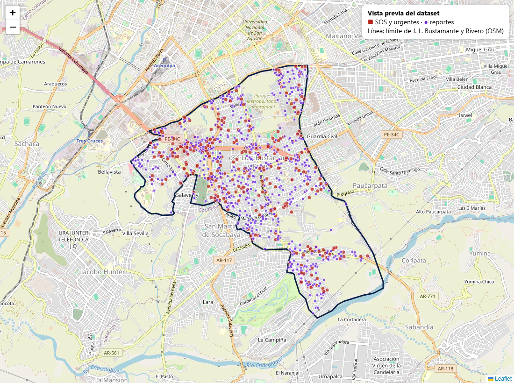

# Dataset de demostración: José Luis Bustamante y Rivero (Arequipa)

Mil casos **simulados** para mostrar todo el sistema en la presentación: la central, el historial de cada caso, el mapa de
concentración, la analítica (tiempos, falsos, cobertura, lo que se repite, el ciudadano y la salud del sistema) y los
acompañamientos.

**Todos los datos son ficticios:** personas, teléfonos, documentos, descripciones y casos. Lo real es la base de las
proporciones (de dónde salen se explica abajo) y la geografía del distrito, tomada de OpenStreetMap.

> Todavía **no se carga** en ningún entorno. Este directorio solo contiene la investigación, el generador y su salida.

## Qué contiene

| Archivo | Contenido |
|---|---|
| `generar.py` | Generador en Python 3.10+, solo con la biblioteca estándar y con semilla fija: siempre produce lo mismo. |
| `fuentes/limite-jlbyr.geojson` | Límite administrativo del distrito (OSM, relación 1887802). |
| `fuentes/lugares.json` | 656 lugares del distrito (OSM): 28 mercados, 65 paraderos, 71 colegios, 151 parques, bancos, grifos, locales nocturnos y 129 urbanizaciones. |
| `fuentes/vias.json` | 597 vías con nombre y su trazado (OSM): avenidas principales y calles residenciales. |
| `salida/casos.json` | Los 1000 casos con su historial completo, evento por evento. |
| `salida/personas.json` | 430 ciudadanos (con perfil y contacto de emergencia), 36 serenos y 6 operadores. |
| `salida/acompanamientos.json` | 120 sesiones de acompañamiento con su recorrido (una posición cada 20 s), confirmaciones y avisos. |
| `salida/turnos.json` | Qué sereno trabajó cada día, en qué turno y en qué sector (descanso rotativo de un día por semana). |
| `salida/actividad.json` | Días en que cada ciudadano usó la app (para la adopción y la retención). |
| `salida/casos.csv` | Una fila por caso, para revisarlo en Excel. |
| `salida/RESUMEN.md` | Las cifras del dataset generado: origen, categoría, estado, tiempos, evaluaciones, hora, día y lugar. |
| `salida/meta.json` | Inicio y fin del periodo y la semilla. |

Para regenerar: `python generar.py` (desde esta carpeta).

## Cifras del dataset

- **Volumen:** 1000 casos en 13 semanas (unos 11 por día), más los fines de semana y creciendo hacia el final, porque la app gana usuarios.
- **Origen:** 70 % reportes (de ellos, 28 % registrados por la central: llamadas, presencial, redes, radio), 29 % SOS y 8 casos urgentes que salen de un acompañamiento.
- **Categorías:** las 13 del sistema, con sus identificadores reales. Encabeza robo o hurto; siguen persona o vehículo sospechoso, alcohol en la vía pública y ruidos molestos.
- **Tiempos de respuesta** (del registro al inicio de la atención):
  - SOS: mediana de unos 13 min, p90 de unos 27 min.
  - Reportes: mediana de unos 35 min.
- **Evaluaciones:** el 42 % de los casos cerrados con ciudadano se evalúa, con un promedio de unos 3,9 de 5. La nota baja cuando el sereno tarda más de lo esperado o no encuentra a nadie.
- **Al final del periodo** quedan casos abiertos (reportes recibidos sin revisar, serenos en camino y en atención), para que la central y «¿Cómo está la central ahora?» tengan algo que mostrar.

Las cifras exactas están en [salida/RESUMEN.md](salida/RESUMEN.md).



## De dónde salen las proporciones

| Qué | Valor usado | Fuente |
|---|---|---|
| Población del distrito | 84 251 hab. (censo 2017, ajustado) | [citypopulation.de, a partir del INEI](https://www.citypopulation.de/en/peru/arequipa/admin/arequipa/040129__josé_luis_bustamante_y_r/) |
| Superficie | 10,83 km² | [Wikipedia](https://en.wikipedia.org/wiki/Jos%C3%A9_Luis_Bustamante_District) |
| Victimización en Arequipa | 38,6 % de la población de 15 años o más (nov 2023 – abr 2024), la más alta del país | [La República, sobre el informe del INEI](https://larepublica.pe/sociedad/2024/06/28/arequipa-puno-o-cusco-esta-es-la-region-mas-insegura-del-peru-segun-el-informe-del-inei-2024-lrsd-2486848) |
| Tipo de delito (nacional urbano, dic 2024 – may 2025, tasa por 100 hab.) | Robo de dinero, cartera o celular 12,3; intento 5,4; robo o intento de robo de vehículo 4,0; estafa 2,1; amenazas 1,9; maltrato y ofensa sexual 1,6; robo de negocio 1,4; extorsión 1,2 | [INEI, Informe técnico de seguridad ciudadana](https://m.inei.gob.pe/media/MenuRecursivo/boletines/boletin_seguridad_ciudadana_dic24-may25.pdf) |
| Víctimas que denuncian | 18,8 % | El mismo informe del INEI |
| Denuncias en el distrito | 172 por robo (4.º lugar en Arequipa) y 31 por extorsión (5.º) | [Pancarta, con datos del Observatorio del Mininter](https://www.pancarta.pe/notas-imprescindibles/sin-plan-de-patrullaje-y-con-deficit-policial-asi-funciona-la-comisaria-de-jose-luis-bustamante-y-rivero/) |
| Comisaría del distrito | 86 policías de 120 requeridos; sin plan de patrullaje por sector 2025 | La misma nota de Pancarta (visita de la Contraloría) |
| Mezcla de las intervenciones de un serenazgo | Licor en la vía pública 2557, vehículos mal estacionados 2342, «gente de mal vivir» 1643, ruidos molestos 1600, consumo de sustancias 1586, … accidentes 242, escándalo 230, delitos contra el patrimonio 112 (IV trimestre 2025) | [Observatorio de Seguridad Ciudadana de Surquillo, boletín n.º 4](https://cdn.www.gob.pe/uploads/document/file/9275738/7610088-boletin-surquillo-iv-trimestre.pdf) |
| Geografía | Límite, urbanizaciones, vías y lugares | [OpenStreetMap](https://www.openstreetmap.org/relation/1887802) (© colaboradores de OpenStreetMap, licencia ODbL) |

Surquillo (Lima) es la referencia más cercana con datos públicos y desglosados por tipo de intervención. No encontré cifras
publicadas del serenazgo de J. L. Bustamante y Rivero. Su población (unos 90 mil habitantes) es parecida.

## Supuestos (lo que no tiene cifra pública)

Cada supuesto está en `generar.py`, en una constante con su comentario, para poder ajustarlo.

- **Qué llega a la central por la app.** Los reportes mezclan lo que patrulla el serenazgo (licor, ruidos, sospechosos, drogas,
  accidentes) con lo que sufre el ciudadano (robo, acoso, amenazas). Robo o hurto pesa más que en el serenazgo, porque la víctima
  sí lo reporta; los vehículos mal estacionados y el comercio ambulatorio no entran, porque no son incidencias de la app.
- **El SOS** es para lo que pone a alguien en peligro ahora: robo en curso, violencia familiar, peleas, acoso y persona en riesgo.
- **Dónde.** Cada categoría cae cerca de un tipo de lugar real:
  - el robo, en mercados (con más peso para el Andrés Avelino Cáceres), paraderos y avenidas;
  - el alcohol y las drogas, en parques;
  - el acoso, en paraderos y colegios;
  - la violencia familiar, en calles residenciales;
  - los accidentes, en las avenidas.
- **Cuándo.** Cada categoría tiene sus horas pico:
  - el robo, en la salida del trabajo (19–20 h) y por la mañana en el mercado;
  - el alcohol, el ruido y las peleas, de noche y sobre todo viernes y sábado;
  - los accidentes, en las horas punta.
- **Serenazgo:** 36 serenos, 12 por turno (mañana 6–14 h, tarde 14–22 h, noche 22–6 h), 3 por sector y 4 sectores (cuadrantes del
  distrito). No hay cifra pública del distrito; es una estimación del orden de 1 sereno por cada 2300 habitantes. Cada sereno
  atiende un caso a la vez; si todos los de su sector están ocupados, va uno de un sector vecino y tarda más.
- **Tiempos:**
  - El SOS aparece en la central en unos 2 s y un operador lo abre en 35 a 55 s (más de noche).
  - El 72 % contesta al primer intento de contacto.
  - Los trayectos son en moto o camioneta: más lentos en hora punta, de noche y desde otro sector.
  - Un 8 % sufre una demora extra.
- **Desenlaces:**
  - De los SOS, el 7 % se cancela y el 5 % se descarta (activación accidental o falso).
  - De los reportes de la app: 66 % se admiten, 13 % se derivan (violencia y extorsión, más a menudo al CEM, la PNP o la Fiscalía) y 21 % se descartan (duplicado, no verificable, falso, fuera de alcance).
  - El resultado del cierre depende de la categoría: un robo termina a menudo sin hallazgo; el alcohol y el ruido, resueltos en el lugar.
- **Precisión del GPS:** buena (4–25 m) en el 87 % de los SOS, imprecisa en el 10 % y sin ubicación en el 3 %. El 15 % de los reportes
  de la app solo trae una referencia en texto, así que no aparece en el mapa (como en la realidad).
- **Personas:**
  - Nombres y apellidos comunes en Arequipa, combinados al azar.
  - Teléfonos que empiezan con `9000`, DNI que empiezan con `00` y correos en el dominio reservado `.test`.
  - El 55 % de los ciudadanos ya estaba registrado antes del periodo; el resto se registra durante él.

## Formato de un caso

Cada caso trae solo lo que le corresponde. Un SOS cerrado, por ejemplo:

```jsonc
{
  "id": "CASO-0010", "origen": "Sos",                // Sos | Reporte | Acompanamiento
  "categoria_inicial": "0199e2b0-…-000000000009",     // identificador real de la categoría
  "ciudadano": "CIU-0300", "registrado_en": "2026-09-01T21:51:01-05:00", "sector": 3,
  "ubicacion": { "latitud": -16.440768, "longitud": -71.524101, "precision_m": 14 },
  "presentado_en_central": "…", "abierto_en_central": "…",
  "intentos_contacto": [{ "en": "…", "operador": "OPE-4", "resultado": "Contactado", "referencia": "…" }],
  "clasificacion": { "categoria": "…", "prioridad": "Baja", "heridos": "No" },
  "eventos": [                                         // en orden; los tipos son los de TipoEventoCaso
    { "tipo": "SosEmitido", "en": "…", "actor": "CIU-0300" },
    { "tipo": "CasoAsignado", "en": "…", "actor": "OPE-4", "sereno": "SER-19" },
    { "tipo": "AtencionIniciada", "en": "…", "actor": "SER-19",
      "inicio": { "distancia_m": 42, "dentro_del_rango": true, "registrado_por_central": false } },
    { "tipo": "CasoCerrado", "en": "…", "actor": "SER-19",
      "cierre": { "resultado": "ResueltoEnElLugar", "resultado_publico": "…", "categoria": "…", "destino": null } }
  ],
  "estado": "Cerrada",                                 // el estado al final del periodo
  "evaluacion": { "puntuacion": 5, "motivos": ["Resolvieron"], "evaluada_en": "…", "comentario": null }
}
```

Un reporte trae además `reporte` (descripción, hora aproximada del hecho, canal, fuente de la ubicación, referencia, cuántas fotos
y, si lo registró la central, quién llamó) y sus decisiones en los eventos (`ReporteAdmitido`, `ReporteDerivado` con su destino,
`ReporteDescartado` con su motivo, `CategoriaCorregida`). Los códigos (resultados, motivos, destinos, canales, prioridades) son los
de `Cad.Contratos`.

## Para cuando se cargue (pendiente)

- **Desplazar las fechas.** El periodo termina el 30/11/2026 a las 20:00. Al cargar, se suma `ahora − fin_del_periodo` a todas las
  fechas, así «hoy», «7 días» y «¿Cómo está la central ahora?» muestran datos.
- **Centrar el mapa del panel en el distrito.** Usar `Panel:Mapa:CentroLatitud = -16.4316` y `CentroLongitud = -71.5290`, zoom 14.
- **Generar al cargar lo que no conviene guardar aquí:**
  - las posiciones de los serenos durante su turno, para la cobertura (un recorrido por su sector cada pocos minutos);
  - las contraseñas de las cuentas;
  - las fotos de los reportes (imágenes de muestra, según `fotos`);
  - los envíos push.
- **Cargar respetando el dominio.** Hacerlo por los casos de uso o con un seeder que construya las entidades, no con SQL suelto: así
  quedan coherentes el estado, la versión, los eventos y las notificaciones al ciudadano.
- **Render.** Revisar el límite de filas y almacenamiento del plan de base de datos (ADR-06: sin costo sin autorización).
