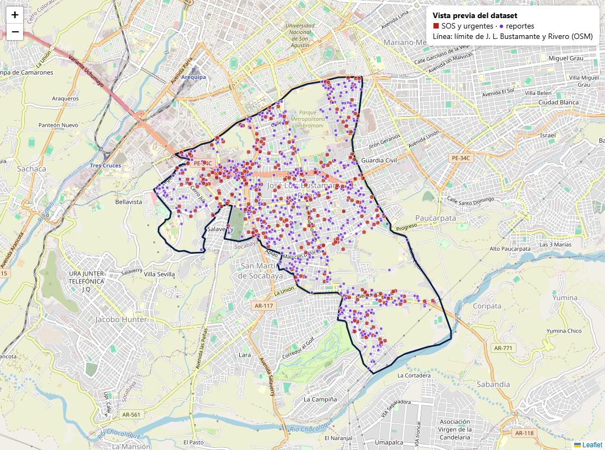

# Dataset de demostración: José Luis Bustamante y Rivero (Arequipa)

Un año de casos **simulados** (unos veinte mil) para mostrar todo el sistema en la presentación: la central, el historial de cada
caso, el mapa de concentración, la analítica (tiempos, falsos, cobertura, lo que se repite, el ciudadano, la salud del sistema, la
evolución por mes y la comparación por bloques) y los acompañamientos.

**Todos los datos son ficticios:** personas, teléfonos, documentos, descripciones y casos. Lo real es la base de las
proporciones (de dónde salen se explica abajo) y la geografía del distrito, tomada de OpenStreetMap.

> Para cargarlo en una base de datos del sistema, usa el [cargador](cargador/README.md): vacía la base de datos y carga el dataset
> con las fechas desplazadas para que el periodo termine en el momento de la carga.

## Qué contiene

| Archivo | Contenido |
|---|---|
| `generar.py` | Generador en Python 3.10+, solo con la biblioteca estándar y con semilla fija: siempre produce lo mismo. |
| `fuentes/limite-jlbyr.geojson` | Límite administrativo del distrito (OSM, relación 1887802). |
| `fuentes/lugares.json` | 656 lugares del distrito (OSM): 28 mercados, 65 paraderos, 71 colegios, 151 parques, bancos, grifos, locales nocturnos y 129 urbanizaciones. |
| `fuentes/vias.json` | 597 vías con nombre y su trazado (OSM): avenidas principales y calles residenciales. |
| `salida/casos.json` | Los casos (unos 20 000 del año y los 25 que quedan en curso al cargar) con su historial completo, evento por evento, sin sangría. |
| `salida/bloques.json` | Los tres bloques (unidad policial, dirección) con las zonas de la cuadrícula de Analítica que agrupa cada uno (ver «Bloques»). |
| `salida/personas.json` | 1300 ciudadanos (con perfil y contacto de emergencia), 36 serenos y 6 operadores. |
| `salida/acompanamientos.json` | 360 sesiones de acompañamiento con su recorrido (una posición cada 20 s), confirmaciones y avisos. |
| `salida/turnos.json` | Qué sereno trabajó cada día, en qué turno y en qué sector (descanso rotativo de un día por semana). |
| `salida/actividad.json` | Días en que cada ciudadano usó la app (para la adopción y la retención). |
| `salida/casos.csv` | Una fila por caso, para revisarlo en Excel. |
| `salida/RESUMEN.md` | Las cifras del dataset generado: origen, categoría, estado, tiempos, evaluaciones, hora, día y lugar. |
| `salida/meta.json` | Inicio y fin del periodo y la semilla. |
| `cargador/` | Programa que vacía una base de datos del sistema y carga el dataset ([cómo se usa](cargador/README.md)). |

Para regenerar: `python generar.py` (desde esta carpeta).

## Cifras del dataset

- **Volumen:** 20 018 casos en 365 días (unos 55 por día, el orden de las intervenciones de un serenazgo de un distrito parecido), más los fines de semana, con la estacionalidad de cada tipo de caso (ver «Estacionalidad») y un crecimiento leve (3 %) porque la app gana usuarios. Los acompañamientos y las posiciones de los serenos solo ocupan los últimos 91 días: es lo que mira la analítica.
- **Origen:** 70 % reportes (de ellos, 28 % registrados por la central: llamadas, presencial, redes, radio), 29 % SOS y 24 casos urgentes que salen de un acompañamiento.
- **Categorías:** las 13 del sistema, con sus identificadores reales. Encabeza robo o hurto; siguen persona o vehículo sospechoso, alcohol en la vía pública y ruidos molestos.
- **Tiempos de respuesta** (del registro al inicio de la atención):
  - SOS: mediana de unos 13 min, p90 de unos 27 min.
  - Reportes: mediana de unos 35 min.
- **Evaluaciones:** el 42 % de los casos cerrados con ciudadano se evalúa, con un promedio de unos 3,9 de 5. La nota baja cuando el sereno tarda más de lo esperado o no encuentra a nadie.
- **Al cargar** quedan abiertos exactamente **5 SOS y 20 reportes** de los últimos minutos, para mostrar la central en vivo (detalle
  en [salida/RESUMEN.md](salida/RESUMEN.md), «Abiertos al cargar»):
  - SOS: 1 sin abrir, 1 con la central intentando contactar, 1 clasificado esperando sereno, 1 en camino y 1 en atención.
  - Reportes: 6 recibidos, 3 en revisión, 7 admitidos esperando sereno (2 registrados por la central), 1 asignado, 1 en camino y
    2 en atención. Los derivados y descartados recientes salen del periodo.
  - Seis serenos de turno quedan ocupados; el resto, libres para asignar durante la presentación.

  Son 25 casos con su propia semilla (`EN_CURSO_AL_CARGAR` en `generar.py`); los pocos del periodo que quedarían abiertos se
  quitan, para que lo abierto sea solo esa lista.

Las cifras exactas están en [salida/RESUMEN.md](salida/RESUMEN.md).



## De dónde salen las proporciones

| Qué | Valor usado | Fuente |
|---|---|---|
| Población del distrito | 84 251 hab. (censo 2017, ajustado) | [citypopulation.de, a partir del INEI](https://www.citypopulation.de/en/peru/arequipa/admin/arequipa/040129__josé_luis_bustamante_y_r/) |
| Superficie | 10,83 km² | [Wikipedia](https://en.wikipedia.org/wiki/Jos%C3%A9_Luis_Bustamante_District) |
| Victimización en Arequipa | 38,6 % de la población de 15 años o más (nov 2023 – abr 2024), la más alta del país | [La República, sobre el informe del INEI](https://larepublica.pe/sociedad/2024/06/28/arequipa-puno-o-cusco-esta-es-la-region-mas-insegura-del-peru-segun-el-informe-del-inei-2024-lrsd-2486848) |
| Tipo de delito (nacional urbano, dic 2024 – may 2025, tasa por 100 hab.) | Robo de dinero, cartera o celular 12,3; intento 5,4; robo o intento de robo de vehículo 4,0; estafa 2,1; amenazas 1,9; maltrato y ofensa sexual 1,6; robo de negocio 1,4; extorsión 1,2 | [INEI, Informe técnico de seguridad ciudadana](https://m.inei.gob.pe/media/MenuRecursivo/boletines/boletin_seguridad_ciudadana_dic24-may25.pdf) |
| Víctimas que denuncian | 18,8 % | El mismo informe del INEI |
| Denuncias en el distrito | 172 por robo (4.º lugar en Arequipa) y 31 por extorsión (5.º) | [Pancarta, con datos del Observatorio del Mininter](https://www.pancarta.pe/notas-imprescindibles/sin-plan-de-patrullaje-y-con-deficit-policial-asi-funciona-la-comisaria-de-jose-luis-bustamante-y-rivero/) |
| Comisaría del distrito | 86 policías de 120 requeridos; sin plan de patrullaje por sector 2025 | La misma nota de Pancarta (visita de la Contraloría) |
| Mezcla de las intervenciones de un serenazgo | Licor en la vía pública 2557, vehículos mal estacionados 2342, «gente de mal vivir» 1643, ruidos molestos 1600, consumo de sustancias 1586, … accidentes 242, escándalo 230, delitos contra el patrimonio 112 (IV trimestre 2025) | [Observatorio de Seguridad Ciudadana de Surquillo, boletín n.º 4](https://cdn.www.gob.pe/uploads/document/file/9275738/7610088-boletin-surquillo-iv-trimestre.pdf) |
| Geografía | Límite, urbanizaciones, vías y lugares | [OpenStreetMap](https://www.openstreetmap.org/relation/1887802) (© colaboradores de OpenStreetMap, licencia ODbL) |

Surquillo (Lima) es la referencia más cercana con datos públicos y desglosados por tipo de intervención. No encontré cifras
publicadas del serenazgo de J. L. Bustamante y Rivero. Su población (unos 90 mil habitantes) es parecida.

## Bloques

El distrito tiene tres unidades policiales, y cada bloque agrupa las zonas de la cuadrícula de Analítica (celdas de 0,005°, unos
550 m, con los mismos nombres que la analítica: letra por columna de oeste a este, número por fila de norte a sur) que atiende una
de ellas. La lista de zonas de cada bloque está en `salida/bloques.json`; cada caso lleva su bloque en `casos.json` y `casos.csv`.

| Bloque | Unidad policial | Zonas | Qué es |
|---|---|---:|---|
| Bustamante y Rivero | Comisaría PNP José Luis Bustamante y Rivero (calle Cipreses s/n) | 24 | Centro y norte: residencial y universitario (Lambramani, Paseo de la Cultura, Hartley), más el suroeste (Villa del Mar, Tasahuayo). |
| Avelino Cáceres | Puesto de Auxilio Rápido de la Plataforma Andrés Avelino Cáceres | 9 | El polo comercial del oeste, dentro de la jurisdicción de JLBYR: 22 de los 28 mercados, 17 bancos y 4 centros comerciales del distrito (OSM). |
| Simón Bolívar | Comisaría PNP Simón Bolívar (Av. Caracas 629) | 20 | Sur y sureste: barrios residenciales, urbanizaciones en consolidación y tierras de cultivo. |

De dónde sale:

- **Las dos comisarías y sus jurisdicciones:** el [Plan de Acción Distrital de Seguridad Ciudadana 2024-2027](https://munibustamante.gob.pe/normas/1739539966.pdf)
  de la municipalidad trata por separado la jurisdicción de cada comisaría (mapa del delito, mapa de riesgo, capacidad operativa) y
  describe la de Simón Bolívar como «barrios residenciales» y «urbanizaciones que están en pleno proceso de consolidación», con
  tierras de cultivo.
- **La frontera entre las dos:** el mismo plan lista las 28 cámaras municipales con su dirección y su jurisdicción. Las de Simón
  Bolívar quedan al sur de la Av. Túpac Amaru y al este de la Prolongación Dolores (Av. Caracas, Las Esmeraldas, La Breña, 3 de
  Octubre, Amauta); las de JLBYR, al norte y al oeste (Lambramani, Paseo de la Cultura, Hartley con Pizarro, Túpac Amaru con Colón,
  Villa del Mar, la cancha de Tasahuayo). Las direcciones se ubicaron con las vías de OpenStreetMap de `fuentes/`.
- **El tercer bloque:** el Puesto de Auxilio Rápido de la Plataforma Andrés Avelino Cáceres, que recibió el monitoreo de cámaras
  junto con las dos comisarías ([Diario Correo, 22/05/2024](https://www.munibustamante.gob.pe/archivos/1768421804.pdf)). Su
  bloque son las celdas de la plataforma comercial, que concentran el robo y el hurto.

Es una aproximación por celdas: una celda va entera al bloque de su centro. Los límites oficiales de cada jurisdicción están en
los mapas del plan, que no se publican como datos.

## Estacionalidad

Cada tipo de caso tiene un peso por mes (`ESTACION` en `generar.py`), simulado a partir de lo que se sabe de Arequipa y del país:

| Grupo | Casos | Patrón |
|---|---|---|
| Patrimonio | robo o hurto, sospechoso, extorsión, vandalismo | Baja en el verano (enero a marzo, −12 a −20 %), cuando parte de la ciudad sale a la costa; sube en julio, noviembre y sobre todo diciembre (+24 %: compras, gratificaciones). |
| Tránsito | accidentes | Sube en julio (Fiestas Patrias, +18 %), agosto (aniversario de Arequipa, +26 %) y diciembre (+24 %); un poco en marzo, con el regreso a clases. |
| Fiesta | alcohol, ruidos, peleas, acoso | Sube en febrero (carnavales, +16 %), julio, agosto y diciembre (+22 a +28 %). |
| Hogar | violencia familiar | Sube en diciembre y enero (fiestas) y un poco en julio y agosto. |

Lo que lo sostiene: el INEI registra más denuncias en el último trimestre del año ([boletín de seguridad ciudadana](https://m.inei.gob.pe/media/MenuRecursivo/boletines/boletin_estadisticas-de-la-criminalidad-seguridad-ciudadana-y-violencia.pdf));
en Arequipa, las detenciones por conducir ebrio se concentran en feriados como Fiestas Patrias ([Diario Correo](https://diariocorreo.pe/edicion/arequipa/arequipa-han-detenido-a-2-mil-607-conductores-por-conducir-en-estado-de-ebriedad-noticia/));
en la Navidad de 2012 las emergencias subieron 30 %, sobre todo por accidentes de tránsito ([El Búho](https://elbuho.pe/archivo/2012/12/25/emergencias-por-navidad-se-incrementan-en-arequipa/index.html)).
No hay una serie mensual pública del distrito: los porcentajes son supuestos para la demostración, no mediciones.

El periodo simulado va del 30/11/2025 al 30/11/2026 y el cargador lo desplaza para que termine al cargar: si se carga lejos de
fines de noviembre, los meses del dataset quedan corridos frente al calendario real.

## Supuestos (lo que no tiene cifra pública)

Cada supuesto está en `generar.py`, en una constante con su comentario, para poder ajustarlo.

- **Qué llega a la central por la app.** Los reportes mezclan lo que patrulla el serenazgo (licor, ruidos, sospechosos, drogas,
  accidentes) con lo que sufre el ciudadano (robo, acoso, amenazas). Robo o hurto pesa más que en el serenazgo, porque la víctima
  sí lo reporta; los vehículos mal estacionados y el comercio ambulatorio no entran, porque no son incidencias de la app.
- **El SOS** es para lo que pone a alguien en peligro ahora: robo en curso, violencia familiar, peleas, acoso y persona en riesgo.
- **Dónde.** Cada categoría cae cerca de un tipo de lugar real:
  - el robo, en mercados (con más peso para el Andrés Avelino Cáceres), paraderos y avenidas;
  - el alcohol y las drogas, en parques;
  - el acoso, en paraderos y colegios;
  - la violencia familiar, en calles residenciales;
  - los accidentes, en las avenidas.
- **Cuándo.** Cada categoría tiene sus horas pico:
  - el robo, en la salida del trabajo (19–20 h) y por la mañana en el mercado;
  - el alcohol, el ruido y las peleas, de noche y sobre todo viernes y sábado;
  - los accidentes, en las horas punta.
- **Serenazgo:** 36 serenos, 12 por turno (mañana 6–14 h, tarde 14–22 h, noche 22–6 h), 3 por sector y 4 sectores (cuadrantes del
  distrito). No hay cifra pública del distrito; es una estimación del orden de 1 sereno por cada 2300 habitantes. Cada sereno
  atiende un caso a la vez; si todos los de su sector están ocupados, va uno de un sector vecino y tarda más.
- **Tiempos:**
  - El SOS aparece en la central en unos 2 s y un operador lo abre en 35 a 55 s (más de noche).
  - El 72 % contesta al primer intento de contacto.
  - Los trayectos son en moto o camioneta: más lentos en hora punta, de noche y desde otro sector.
  - Un 8 % sufre una demora extra.
- **Desenlaces:**
  - De los SOS, el 7 % se cancela y el 5 % se descarta (activación accidental o falso).
  - De los reportes de la app: 66 % se admiten, 13 % se derivan (violencia y extorsión, más a menudo al CEM, la PNP o la Fiscalía) y 21 % se descartan (duplicado, no verificable, falso, fuera de alcance).
  - El resultado del cierre depende de la categoría: un robo termina a menudo sin hallazgo; el alcohol y el ruido, resueltos en el lugar.
- **Precisión del GPS:** buena (4–25 m) en el 87 % de los SOS, imprecisa en el 10 % y sin ubicación en el 3 %. El 15 % de los reportes
  de la app solo trae una referencia en texto, así que no aparece en el mapa (como en la realidad).
- **Personas:**
  - Nombres y apellidos comunes en Arequipa, combinados al azar.
  - Teléfonos que empiezan con `9000`, DNI que empiezan con `00` y correos en el dominio reservado `.test`.
  - El 55 % de los ciudadanos ya estaba registrado antes del periodo; el resto se registra durante él.

## Formato de un caso

Cada caso trae solo lo que le corresponde. Un SOS cerrado, por ejemplo:

```jsonc
{
  "id": "CASO-0010", "origen": "Sos",                // Sos | Reporte | Acompanamiento
  "categoria_inicial": "0199e2b0-…-000000000009",     // identificador real de la categoría
  "ciudadano": "CIU-0300", "registrado_en": "2026-09-01T21:51:01-05:00", "sector": 3,
  "ubicacion": { "latitud": -16.440768, "longitud": -71.524101, "precision_m": 14 },
  "presentado_en_central": "…", "abierto_en_central": "…",
  "intentos_contacto": [{ "en": "…", "operador": "OPE-4", "resultado": "Contactado", "referencia": "…" }],
  "clasificacion": { "categoria": "…", "prioridad": "Baja", "heridos": "No" },
  "eventos": [                                         // en orden; los tipos son los de TipoEventoCaso
    { "tipo": "SosEmitido", "en": "…", "actor": "CIU-0300" },
    { "tipo": "CasoAsignado", "en": "…", "actor": "OPE-4", "sereno": "SER-19" },
    { "tipo": "AtencionIniciada", "en": "…", "actor": "SER-19",
      "inicio": { "distancia_m": 42, "dentro_del_rango": true, "registrado_por_central": false } },
    { "tipo": "CasoCerrado", "en": "…", "actor": "SER-19",
      "cierre": { "resultado": "ResueltoEnElLugar", "resultado_publico": "…", "categoria": "…", "destino": null } }
  ],
  "estado": "Cerrada",                                 // el estado al final del periodo
  "evaluacion": { "puntuacion": 5, "motivos": ["Resolvieron"], "evaluada_en": "…", "comentario": null }
}
```

Un reporte trae además `reporte` (descripción, hora aproximada del hecho, canal, fuente de la ubicación, referencia, cuántas fotos
y, si lo registró la central, quién llamó) y sus decisiones en los eventos (`ReporteAdmitido`, `ReporteDerivado` con su destino,
`ReporteDescartado` con su motivo, `CategoriaCorregida`). Los códigos (resultados, motivos, destinos, canales, prioridades) son los
de `Cad.Contratos`.

## Cómo se carga

Con el [cargador](cargador/README.md). Allí se explica también:

- qué genera al cargar, porque no conviene guardarlo aquí: las posiciones de los serenos, las claves, las fotos de muestra y los envíos push;
- cuándo conviene cargar para una presentación;
- cuánto ocupa (unos 110 MB).

Para que el mapa del panel se abra sobre el distrito, el servidor necesita `Panel:Mapa:CentroLatitud = -16.4316`,
`Panel:Mapa:CentroLongitud = -71.5290` y `Panel:Mapa:Zoom = 14`. En Render se configuran como variables de entorno:
`Panel__Mapa__CentroLatitud`, `Panel__Mapa__CentroLongitud` y `Panel__Mapa__Zoom`.
